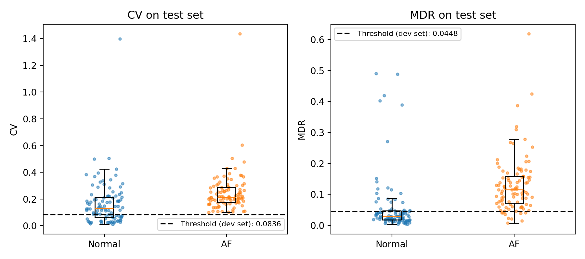

# EEM4011 Project: AF Screening from R–R Intervals

Research-oriented preliminary screening for atrial fibrillation (AF) from R–R intervals in short, single-lead ECG recordings. A standard-deviation-based coefficient of variation (CV) is compared with a median-based measure (MDR), using the same R-peak detector and the same record split. This work does not provide a diagnosis.

## Data
PhysioNet/CinC Challenge 2017 (the data are not stored in this repository; the code reads them directly from PhysioNet):
https://physionet.org/content/challenge-2017/1.0.0/

Only 200 AF and 200 Normal records are used. For each class, the first 100 records form the development set and the next 100 form the test set. The dataset has no subject identifiers, so records from the same person may appear in both sets (limitation).

## How to run
1. Open the notebook in Google Colab.
2. Run the cells in order: data loading (wfdb, about 20 min), baseline (CV/MDR; thresholds are selected on the development set only), bootstrap + McNemar test.

## Main result (test set, F1, positive class = AF)
- CV: 0.747
- MDR: 0.826
- F1(MDR) − F1(CV): 0.079, bootstrap 95% CI [0.024, 0.133] (2000 resamples, seed 0)
- Exact McNemar test (per record): CV-only correct = 14, MDR-only correct = 43, p = 0.0002
- 1 undecided record per method (fewer than 5 R–R intervals) is counted as an error.

| Method | TP | FN | FP | TN | F1 | Sensitivity | Specificity |
|---|---|---|---|---|---|---|---|
| CV  | 99 | 1  | 66 | 34 | 0.747 | 0.99 | 0.34 |
| MDR | 90 | 10 | 28 | 72 | 0.826 | 0.90 | 0.72 |

Thresholds were selected on the development set only (CV: 0.0836, MDR: 0.0448; development F1 0.760 and 0.844).

## Additional preliminary analyses (same 400 records, same detector and threshold rule)
These were run locally after the main experiment. The analysis scripts and reports are not part of this repository yet; the numbers below come from those local reports.
- **Repeated splits:** over 200 random 100+100 splits (thresholds re-selected on each development set), MDR had the higher test F1 in 200 of 200 splits (mean difference 0.073).
- **Error analysis:** of the 66 CV false positives among the 100 Normal test records, 43 were records MDR classified correctly; most had a few very short R–R intervals (probable extra detected peaks) inside an otherwise regular rhythm.
- **Simulated peak errors:** adding random extra/missed peaks to the R–R series (thresholds frozen from clean data) degraded CV much faster than MDR. This is a simulation, and the CV collapse is largely due to the frozen threshold.
- **Signal-quality strata:** the MDR advantage did not grow with noise, so the hypothesis that MDR is more robust to peak errors is only weakly supported so far.
- **Simple ML models** (logistic regression, random forest on five R–R features, trained on the development set only) reached test F1 of about 0.88, above MDR (0.826). They use CV and MDR as features, so this does not contradict MDR; it shows that extra features help.

## Figures
- `fig1_scores.png`: CV and MDR scores of the test records, with the thresholds selected on the development set.
- `figures/fig2_simulated_peak_errors_clean_threshold.png`: **simulation.** Random extra/missed R peaks added to the R–R series of the test records; thresholds frozen from clean development data. F1 and specificity of CV and MDR versus error rate (mean ± std over 20 seeds).
- `figures/fig3_simulated_peak_errors_retuned_threshold.png`: same simulation, with thresholds re-selected on development data corrupted in the same way.
- `figures/fig4_record_A00222.png`, `fig4_record_A00223.png`, `fig4_record_A00261.png`, `fig4_record_A00303.png`, `fig4_record_A00314.png`: example Normal test records (R peaks marked, R–R series below). A00222, A00223 and A00303: CV false positive, MDR correct (A00303 and A00223 show short bursts of extra detected peaks). A00261: both correct (control). A00314: both wrong (extreme example). Plots only; no data files are included in this repository.

## Planned work
Independent validation on a second open database (MIT-BIH Atrial Fibrillation Database) with the thresholds frozen from the Challenge development set, record-level bootstrap confidence intervals, and a comparison of automatic and manually corrected beat annotations. Nothing from that database has been analysed yet.

## Limitations
- No subject identifiers, so subject-level separation of development and test records cannot be guaranteed.
- Results are for a 400-record subset and are not directly comparable with published results on other datasets or experiments.
- The notebook's last cell (bootstrap and McNemar test) has not been run in Colab yet; the values above for the F1 difference and p-value come from an equivalent local run.
