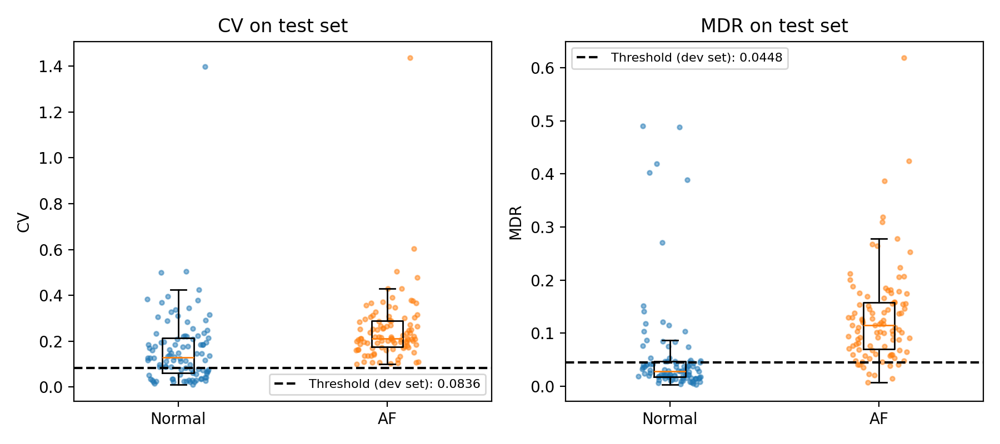

# EEM4011 Project: AF Screening from R–R Intervals

Research-oriented preliminary screening for atrial fibrillation (AF) from R–R intervals in short, single-lead ECG recordings. A standard-deviation-based coefficient of variation (CV) is compared with a median-based measure (MDR), using the same R-peak detector and the same record split. This work does not provide a diagnosis.

## Data
PhysioNet/CinC Challenge 2017 (the data are not stored in this repository; the code reads them directly from PhysioNet):
https://physionet.org/content/challenge-2017/1.0.0/

Only 200 AF and 200 Normal records are used. For each class, the first 100 records form the development set and the next 100 form the test set. The dataset has no subject identifiers, so records from the same person may appear in both sets (limitation).

## How to run
1. Open the notebook in Google Colab.
2. Run the cells in order: data loading (wfdb, about 20 min), baseline (CV/MDR; thresholds are selected on the development set only), bootstrap + McNemar test.

## Main result (test set, F1, positive class = AF)
- CV: 0.747
- MDR: 0.826
- F1(MDR) − F1(CV): 0.079, bootstrap 95% CI [0.024, 0.133] (2000 resamples, seed 0)
- Exact McNemar test (per record): CV-only correct = 14, MDR-only correct = 43, p = 0.0002
- 1 undecided record per method (fewer than 5 R–R intervals) is counted as an error.

| Method | TP | FN | FP | TN | F1 | Sensitivity | Specificity |
|---|---|---|---|---|---|---|---|
| CV  | 99 | 1  | 66 | 34 | 0.747 | 0.99 | 0.34 |
| MDR | 90 | 10 | 28 | 72 | 0.826 | 0.90 | 0.72 |

Thresholds were selected on the development set only (CV: 0.0836, MDR: 0.0448; development F1 0.760 and 0.844).

## Limitations
- No subject identifiers, so subject-level separation of development and test records cannot be guaranteed.
- Results are for a 400-record subset and are not directly comparable with published results on other datasets or experiments.
